# CSJS

[](https://github.com/DotNetVibeCoderz/Vibe_Language/actions/workflows/ci.yml)

**C# that runs as JavaScript.** A transpiler, an interop layer, a CLI, an editor with an AI
assistant, and a browser playground — so a .NET developer can write for the web without leaving
C#.

*[Baca dalam Bahasa Indonesia →](README.id.md)*

<p align="center">
  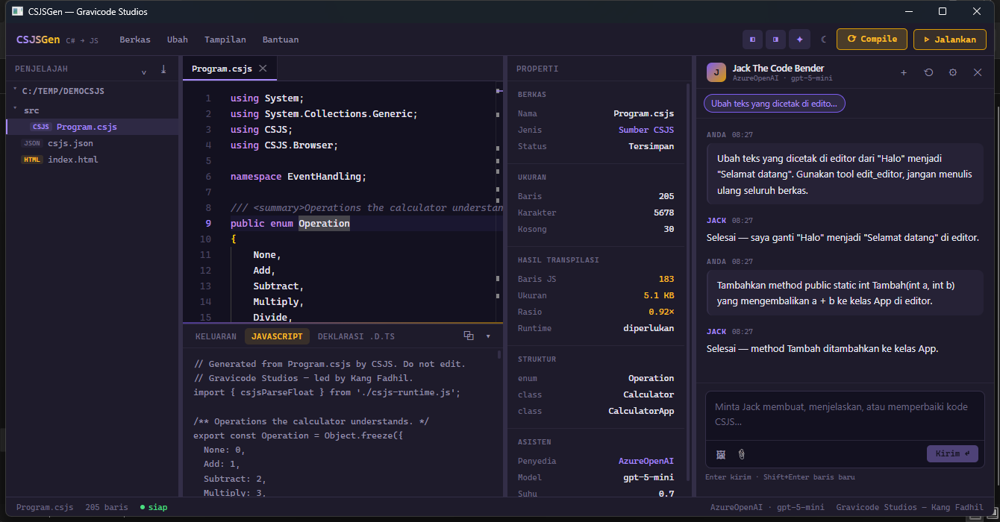
</p>

---

## What it does

You write C#:

```csharp
using System;
using CSJS;
using CSJS.Browser;

[JsExport(Global = true)]
public static class App
{
    public static void Start()
    {
        var heading = Document.QuerySelector("h1");
        if (heading is not null)
        {
            heading.TextContent = Greet("Dunia");
        }
    }

    public static string Greet(string name) => $"Halo, {name}!";
}
```

You get JavaScript — readable, module-shaped, and tree-shakeable:

```javascript
// Generated from Program.csjs by CSJS. Do not edit.

export class App {

  static Start() {
    const heading = document.querySelector('h1');
    if (!(heading === null)) {
      heading.textContent = App.Greet('Dunia');
    }
  }

  static Greet(name) {
    return `Halo, ${name}!`;
  }
}
globalThis.App = App;
```

Plus a `.d.ts` so TypeScript consumers keep the types, and a source map so a breakpoint in the
C# stops on the right line in the browser.

## Built with it

Each of these was scaffolded from a template in CSJSGen and photographed running in a browser.
The C# is the only source.

<p align="center">
  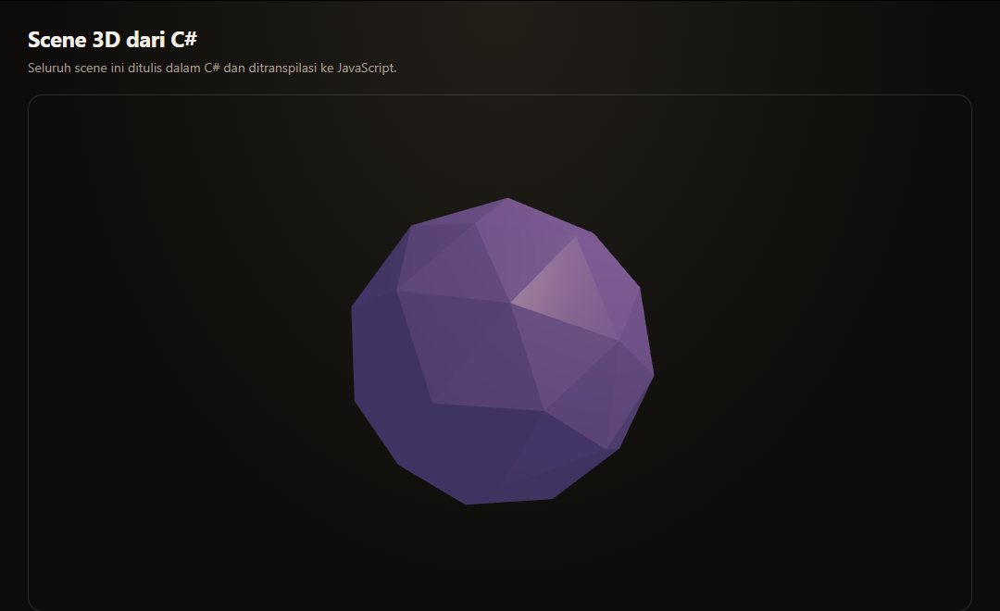
  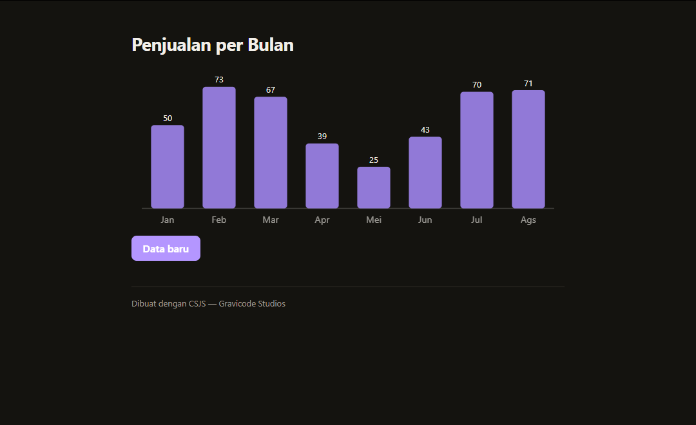
</p>
<p align="center">
  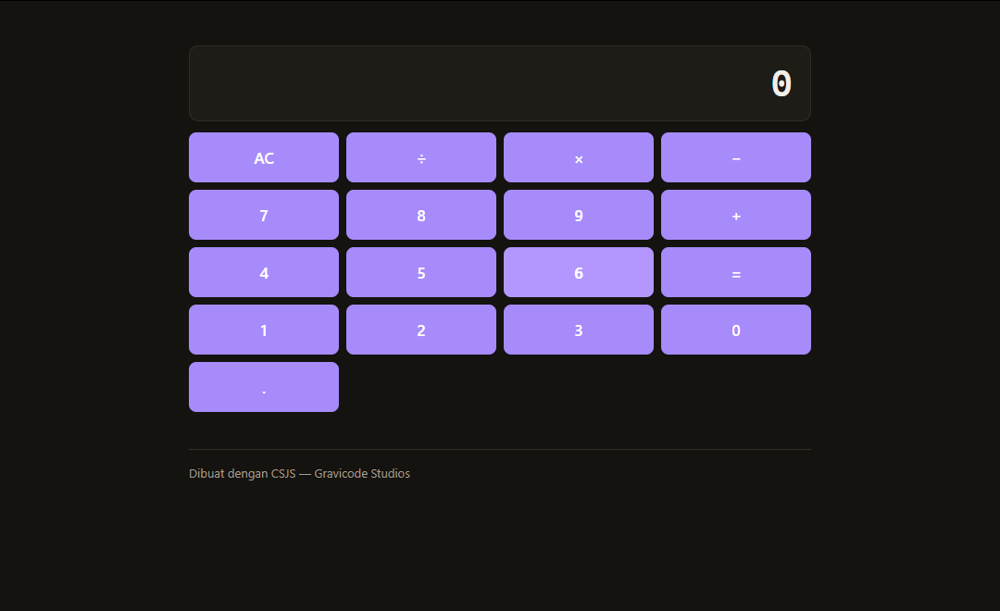
  
</p>

More in the [documentation gallery](docs/README.md#applications-built-with-csjsgen).

## Install

```bash
# Project templates — the quickest start, and no global tool needed
dotnet new install CSJS.Templates

# The CLI. Install either or both — they differ only in command name.
dotnet tool install --global CSJS.Cli.Standalone   # gives you  cs2js build
dotnet tool install --global CSJS.Cli              # gives you  dotnet cs2js build

# The library, for referencing the transpiler from your own code
dotnet add package CSJS.Core
```

## Start a project

```bash
dotnet new csjs-app -n HelloWorld
cd HelloWorld
dotnet run
```

Then open <http://localhost:5080>. The project is an ordinary `.csproj` built by
[`CSJS.Build`](src/CSJS.Build), so Visual Studio, Rider, and VS Code give full IntelliSense and
CSJS errors land in the IDE error list. The other templates are `csjs-lib` (an npm library with
`.d.ts` typings), `csjs-aspnet`, `csjs-blazor`, and `csjs-console` — see [templates](templates).

With the CLI instead:

```bash
cs2js new HelloWorld
cd HelloWorld
cs2js serve        # rebuilds on save; the page reloads, CSS swaps in place
```

## The CLI

| Command | What it does |
| --- | --- |
| `cs2js new <name>` | Scaffold a project with `csjs.json`, a source file, and a host page. |
| `cs2js build [dir]` | Transpile to the output directory. |
| `cs2js run [dir\|file]` | Build, then execute with Node. |
| `cs2js watch [dir]` | Rebuild whenever a source file changes. |
| `cs2js serve [dir]` | Build and serve over HTTP with live reload (`--port`, default 5080). |
| `cs2js build --bundle [--minify]` | One `bundle.js` with only the runtime helpers used, and its source map. |
| `cs2js add <npm-package>` | Fetch a package and generate C# bindings from its TypeScript declarations. |
| `cs2js bind <file.d.ts>` | Generate C# bindings from a declaration file. |
| `cs2js lsp` | Language server: C# IntelliSense with CSJS diagnostics, for any LSP editor. |

Builds are incremental — an unchanged project is skipped, and `watch` re-emits only what changed.
Node stack traces from `cs2js run` point at your C# lines.

Every project setting has a default, so a project with sources in `src/` builds without a config
file at all. When you want one, `csjs.json` looks like this:

```json
{
  "name": "HelloWorld",
  "source": "src",
  "output": "dist",
  "module": "esm",
  "typeDefinitions": true,
  "sourceMaps": true,
  "html": "index.html"
}
```

## What C# is supported

**Supported, through C# 14.** Classes, interfaces, structs with real value semantics, records,
enums, generics, inheritance and virtual dispatch, properties (auto, computed, and the `field`
keyword), indexers, events, delegates, lambdas and closures, `async`/`await`, iterators, LINQ in
method and full query syntax (`join`, `let`, `group … into`), pattern matching, switch
expressions, tuples and deconstruction, `ref` and `out` parameters, `checked`/`unchecked`
arithmetic, extension methods and C# 14 extension members, null-conditional assignment, `using`,
typed catch clauses, string interpolation with format specifiers, and operator overloading.

The framework surface includes strings, math, collections (`List`, `Dictionary`, `HashSet`,
`Stack`, `Queue`), the full LINQ operator set, `Regex`, `DateTime` and `TimeSpan`,
`System.Text.Json`, `StringBuilder`, and the `Enum` APIs. Whole programs are run on .NET and on
Node in the test suite, and must print the same thing.

**How types map.** This table is the contract — the emitter, the `.d.ts` writer, and the
IntelliSense provider all read the same table, so they cannot disagree.

| C# | JavaScript | TypeScript |
| --- | --- | --- |
| `int`, `double`, `decimal` | `number` | `number` |
| `long`, `ulong` | `BigInt` | `bigint` |
| `string`, `char` | `string` | `string` |
| `bool` | `boolean` | `boolean` |
| `T[]`, `List<T>` | `Array` | `T[]` |
| `Dictionary<K,V>` | `Map` | `Map<K, V>` |
| `HashSet<T>` | `Set` | `Set<T>` |
| `Task`, `Task<T>` | `Promise` | `Promise<T>` |
| `IEnumerable<T>` from an iterator | generator | `Generator<T>` |
| `enum` | frozen object, both directions | const object + union type |
| `record` | class with value equality | class |
| `DateTime` | `Date` | `Date` |
| `TimeSpan` | milliseconds | `number` |
| `struct` | class, cloned wherever C# copies | class with `$clone()` |

**Not supported, and reported rather than mistranslated:** pointers and `unsafe`, and any BCL
member without a mapping.
That last one matters: an unmapped member is a build error, not JavaScript that fails at runtime.

`lock` compiles with a warning — JavaScript is single-threaded, so the body runs but the lock
means nothing.

## Calling JavaScript from C#

Declare a binding and the transpiler emits a real ES import. No wrapper, no shim:

```csharp
[JsImport("three", "Scene")]
public class Scene
{
    public Scene() => throw new JsExternException();
    public void Add(Object3D child) => throw new JsExternException();
}
```

```javascript
import { Scene } from 'three';
```

| Attribute | What it does |
| --- | --- |
| `[JsImport("mod", "Export")]` | Bind to a module export; emits an `import`. |
| `[JsGlobal("name")]` | Bind to an existing global; emits nothing. |
| `[JsExport(Global = true)]` | Export the type, and assign it to `globalThis`. |
| `[JsName("jsName")]` | Override the emitted name. |
| `[JsBody("…")]` | Supply a raw JavaScript body for a method. |
| `[JsTemplate("{this}[{0}]")]` | Rewrite every call site into an expression. |
| `[JsObjectLiteral]` | Emit instances as `{ … }` rather than a class. |
| `[JsIgnore]` | Leave the declaration out entirely. |

Members of a binding type are camelCased automatically, so `QuerySelector` emits
`querySelector` without needing `[JsName]` on every member.

### The whole web platform, already bound

[`CSJS.Web`](src/CSJS.Web) is every `lib.dom` interface as typed C# — 1,464 types and 19,338
members, from the DOM and Canvas to Web Audio, WebGL, WebGPU, WebRTC, Web Crypto, IndexedDB, and
WebSocket — generated by CSJS's own binding generator, with real inheritance and MDN docs on
every member. It ships with the CLI, the language server, and `CSJS.Build`, so there is nothing
to install:

```csharp
using CSJS.Web;

var ctx = Dom.Query<HTMLCanvasElement>("#stage")!.GetContext2D();
ctx.FillStyle = "#a78bfa";
ctx.FillRect(0, 0, 120, 80);

var digest = await Js.Crypto.Subtle.Digest("SHA-256", new TextEncoder().Encode("hello"));
var hex = string.Concat(new Uint8Array(digest).ToArray().Select(b => b.ToString("x2")));
await Js.Navigator.Clipboard.WriteText(hex);
```

Each call compiles to exactly the JavaScript it names — `document.querySelector('#stage')`,
`crypto.subtle.digest(…)` — with no wrapper in between.

## The Gallery

[`gallery/`](gallery) is a showcase app written entirely in C#: canvas, audio, the camera, a Web
Worker that is itself C#, files, storage, crypto — and an API playground speaking REST, gRPC-Web,
SignalR, Socket.IO, WebSocket, and Server-Sent Events to a live ASP.NET Core server. Every demo
sits beside the JavaScript it became, joined at the seam: hover a C# line and threads drawn from
the module's own source map show which JavaScript it turned into.

```bash
dotnet run --project gallery/CSJS.Gallery
```

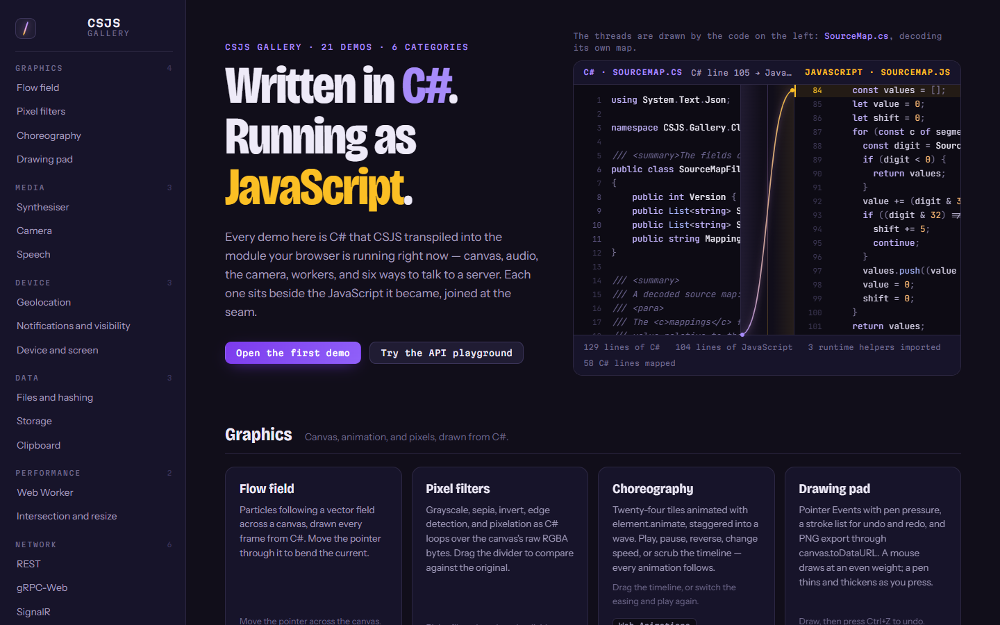

*The home page: the hero seam runs on `SourceMap.cs`, the code that draws the threads.*

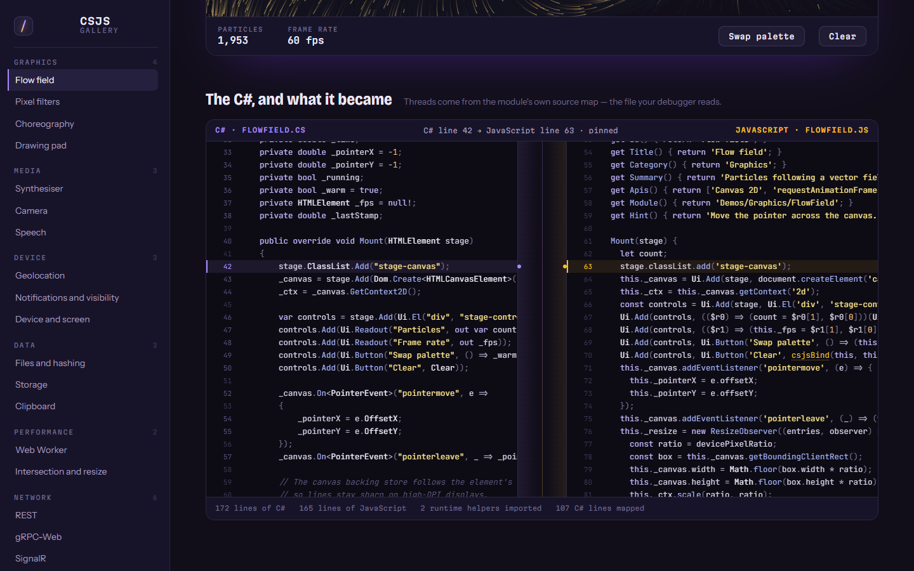

*The seam under a demo: the pinned C# line and the JavaScript it became, side by side.*

<table>
  <tr>
    <td width="33%">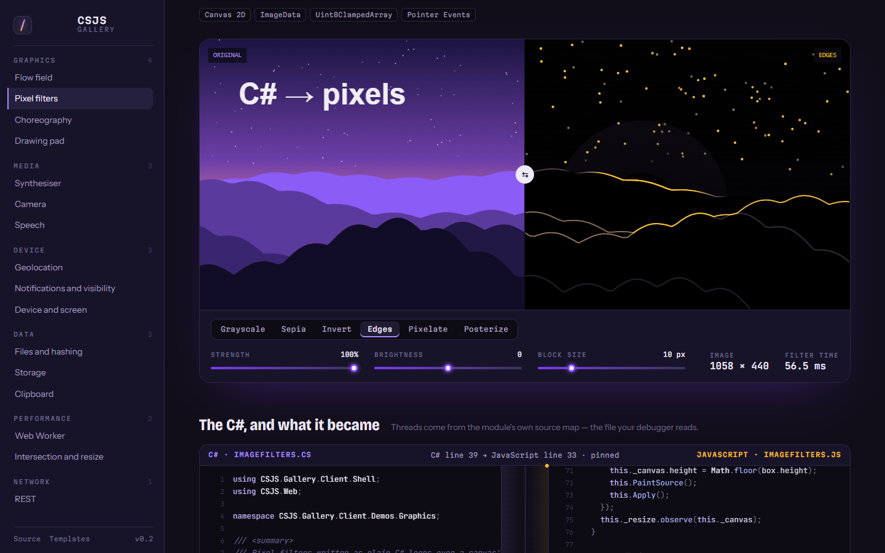<br><sub>Pixel filters</sub></td>
    <td width="33%">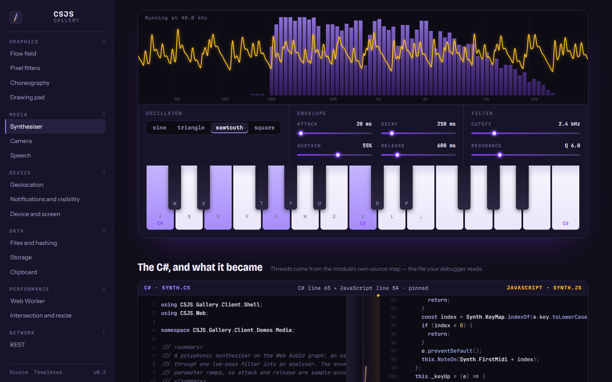<br><sub>Synthesiser</sub></td>
    <td width="33%">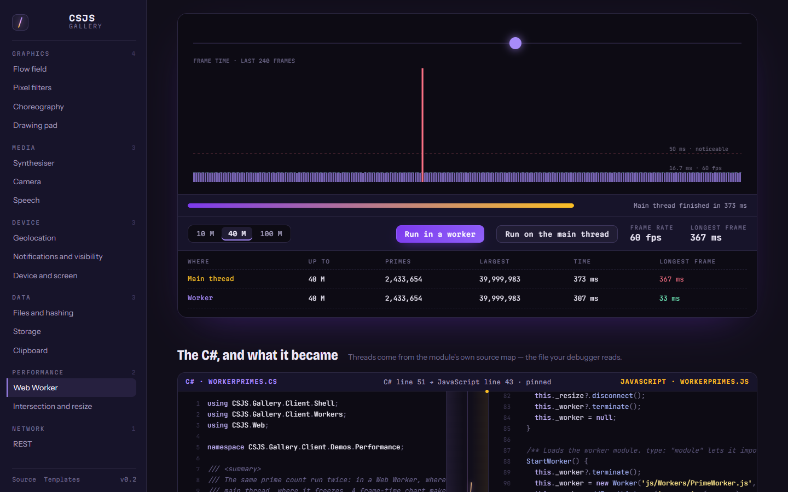<br><sub>Web Worker in C#</sub></td>
  </tr>
  <tr>
    <td width="33%">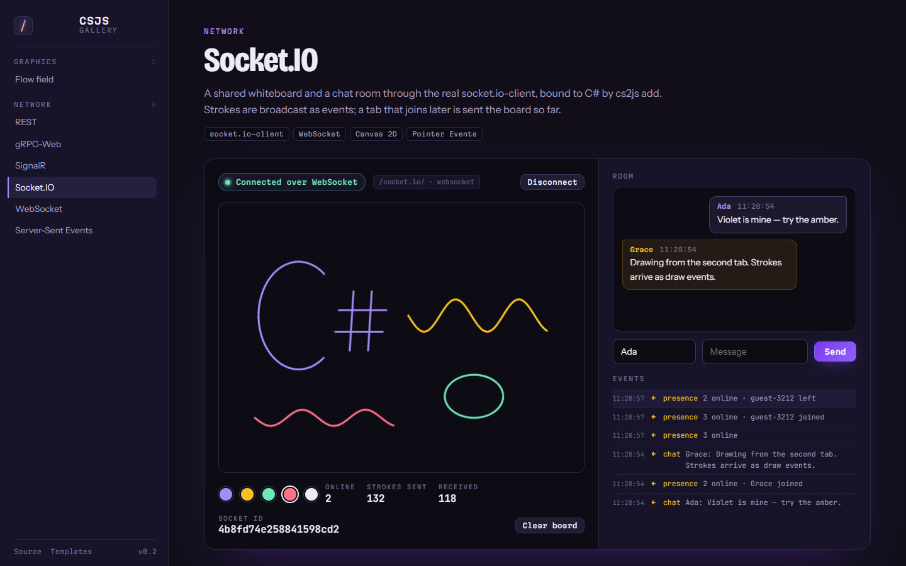<br><sub>Socket.IO whiteboard</sub></td>
    <td width="33%">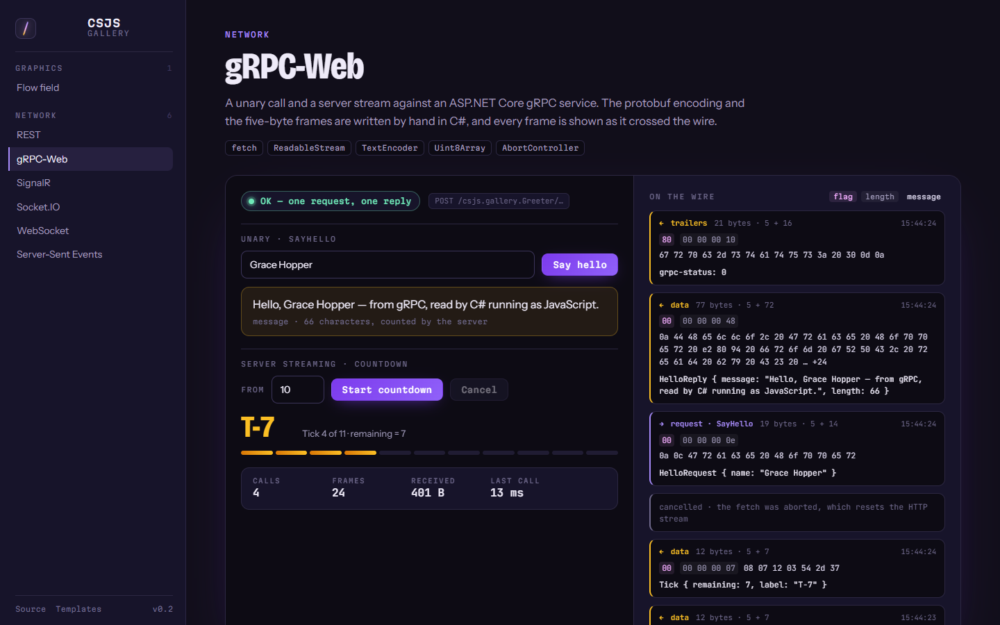<br><sub>gRPC-Web, framed by hand</sub></td>
    <td width="33%">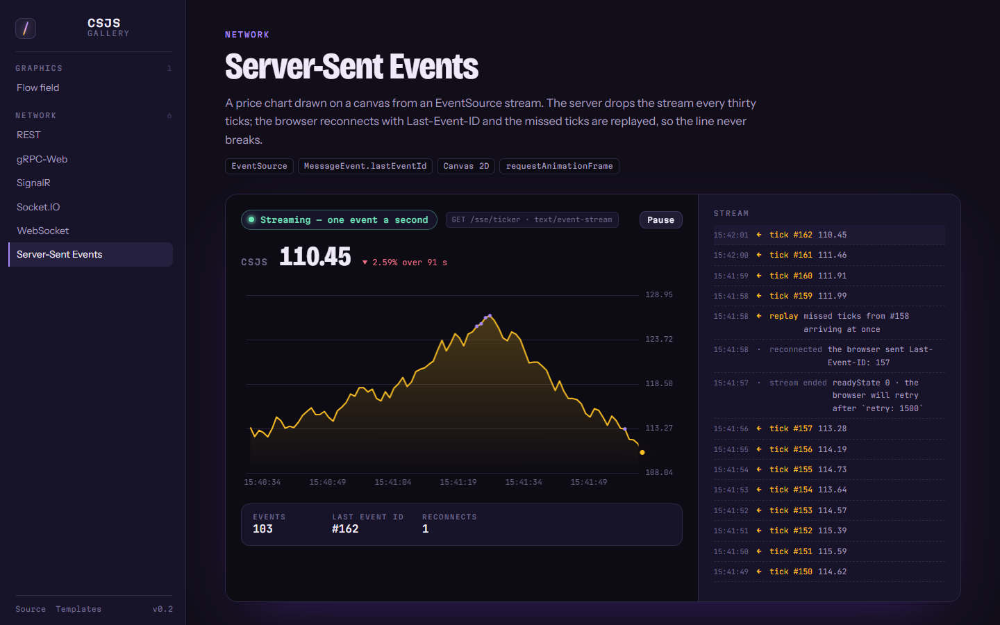<br><sub>Server-Sent Events</sub></td>
  </tr>
</table>

See [docs/gallery.md](docs/gallery.md).

## The pieces

| | |
| --- | --- |
| **[`CSJS.Core`](src/CSJS.Core)** | The transpiler: Roslyn front end, JavaScript emitter, `.d.ts` emitter, source maps. |
| **[`CSJS.Interop`](src/CSJS.Interop)** | Interop attributes and typed browser bindings. |
| **[`CSJS.Web`](src/CSJS.Web)** | The whole web platform as typed C#, generated from `lib.dom`. |
| **[`CSJS.Cli`](src/CSJS.Cli)** | `cs2js` — build, run, watch, serve, new, bind, add, lsp. |
| **[`CSJS.Build`](src/CSJS.Build)** | MSBuild integration: `dotnet build` transpiles a `.csproj`. |
| **[`CSJS.LanguageService`](src/CSJS.LanguageService)** | Completion, hover, signature help, definition, and diagnostics — shared by `cs2js lsp` and CSJSGen. |
| **[`CSJS.Testing`](src/CSJS.Testing)** | Write tests in C#, run them on a JavaScript runtime. |
| **[`CSJSGen`](src/CSJSGen)** | Desktop editor with **Jack The Code Bender**, an AI assistant. |
| **[Gallery](gallery)** | Live web-platform demos and an API playground, all C#, each beside its JavaScript. |
| **[Playground](playground)** | The transpiler running in the browser, via WebAssembly. Share a program as a link. |
| **[VS Code extension](vscode-extension)** | Language client for `cs2js lsp`, highlighting, tasks, debugging bridge. |
| **[Templates](templates)** | `CSJS.Templates`: browser app, npm library, ASP.NET + JS, Blazor Hybrid, Console-to-Web. |
| **[Framework bindings](bindings)** | React, Vue, and Angular, generated from their `.d.ts` by `cs2js add`. |
| **[Samples](samples)** | Hello world, DOM, events, three.js. |

## CSJSGen

An Avalonia application whose editor surface is Blazor: a file tree, **Monaco** holding your C#,
a properties panel, and an output pane showing the emitted JavaScript and `.d.ts` beside the
source. Panels hide and resize, and the layout is remembered between sessions; completion, hover,
signature help, and live diagnostics come from the same language service `cs2js lsp` uses.

**Berkas → Proyek baru** offers 21 templates, from a blank project to a three.js scene. Every one
is a working application that builds, not a stub.

Beside it sits **Jack The Code Bender** — an assistant built on Semantic Kernel with pluggable
providers (OpenAI, Azure OpenAI, Anthropic, Gemini, DeepSeek, Ollama). Jack can compile, run, and
edit the code he writes, because those are kernel functions rather than claims — and each call
appears in the conversation as a collapsible step, with its arguments and result:

| Function | What it does |
| --- | --- |
| `Csjs.compile` | Transpile and report real diagnostics. |
| `Csjs.run` | Execute the output on Node and return what it printed. |
| `Csjs.check_support` | Probe whether a C# feature can be transpiled. |
| `Csjs.emit_type_definitions` | Show the generated `.d.ts`. |
| `Csjs.write_editor` / `edit_editor` / `insert_into_editor` | Change the open file, then compile it to check. |
| `Web.search`, `Web.scrape_page`, `Web.read_file_from_url` | Reach the internet. |
| `Utility.current_datetime`, `calculate`, `statistics`, … | The things models get wrong. |

Adding a capability means adding a kernel function; the chat loop stays untouched. Persona,
temperature, model, and keys live in `app.config` — copy `src/CSJSGen/app.config.template` to
get started, or set the provider's API key as an environment variable.

## Testing transpiled code

Tests are written in C# and executed on Node, so what is verified is the emitted JavaScript
rather than the C# original:

```csharp
[CsjsTest("integer division truncates")]
public static void IntegerDivision()
{
    Assert.Equal(3, 7 / 2);
}
```

## Documentation

Full documentation lives in [`docs/`](docs/):

- [Getting started](docs/getting-started.md)
- [Language support](docs/language-support.md) — what transpiles, and what each construct becomes
- [Interop guide](docs/interop.md)
- [CLI reference](docs/cli.md) — including bundling, live reload, and `CSJS.Build`
- [Bindings](docs/bindings.md) — generating C# from TypeScript declarations
- [Language server](docs/language-server.md) — VS Code, Rider, Visual Studio, Neovim
- [CSJSGen guide](docs/csjsgen.md)
- [Architecture](docs/architecture.md)

## Build from source

```bash
git clone https://github.com/DotNetVibeCoderz/Vibe_Language
cd Vibe_Language/CSJS
dotnet build CSJS.slnx
dotnet test tests/CSJS.Core.Tests/CSJS.Core.Tests.csproj
```

## Roadmap

See [Plan.md](Plan.md) for the roadmap and [Progress.md](Progress.md) for current status.

## License

MIT.

---

Built by **Gravicode Studios**, led by **Kang Fadhil**.
