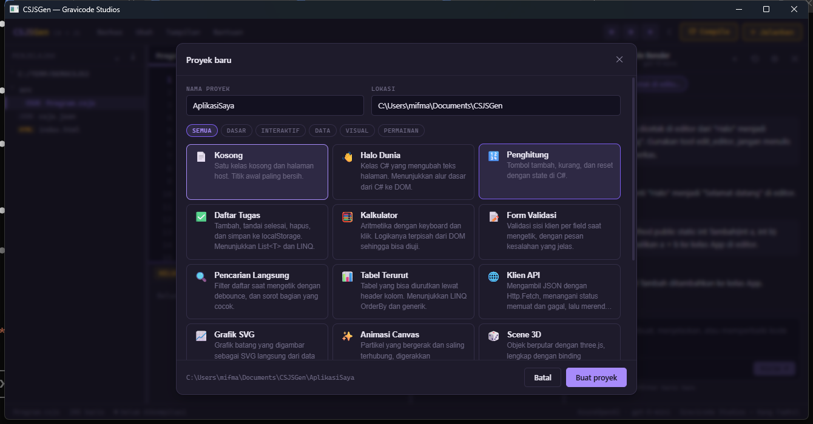
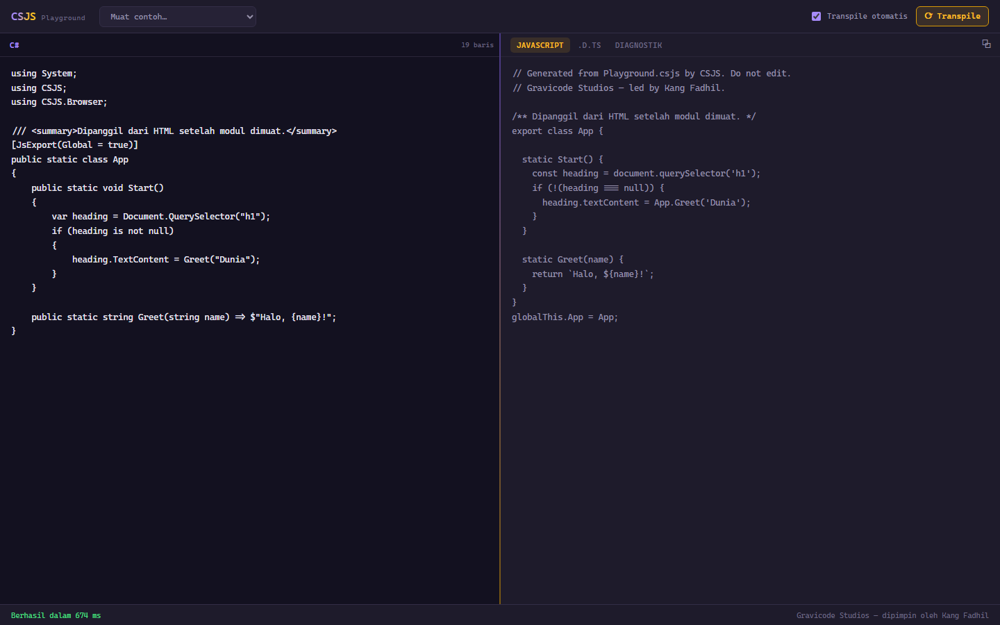
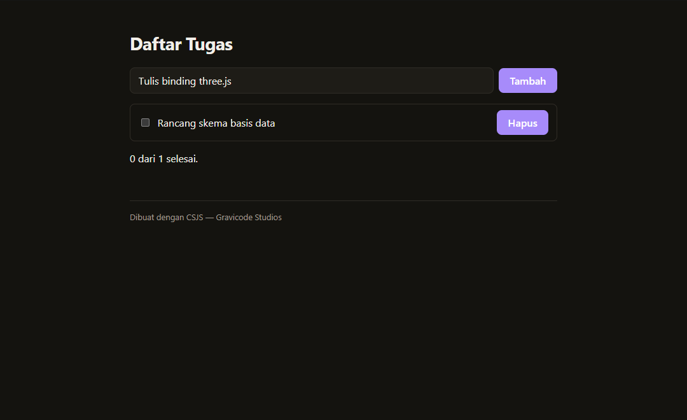
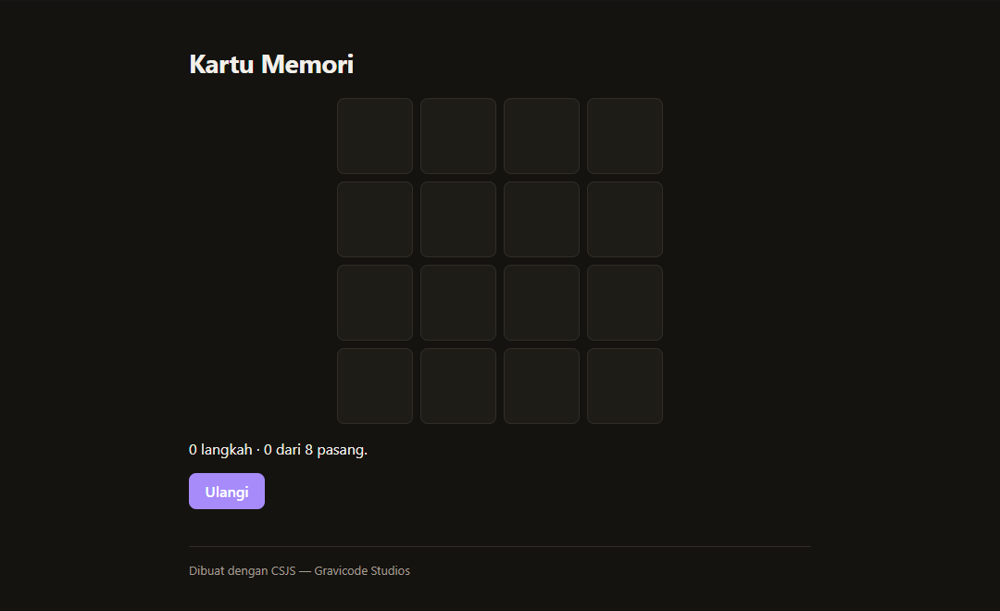

# CSJS documentation

| Document | What it covers |
| --- | --- |
| [Getting started](getting-started.md) | Install, first project, the edit loop. |
| [Language support](language-support.md) | What transpiles, what it becomes, what to use instead. |
| [Interop guide](interop.md) | Calling JavaScript from C#, and the reverse. |
| [CLI reference](cli.md) | Every command, every `csjs.json` field, every diagnostic. |
| [CSJSGen](csjsgen.md) | The desktop editor and Jack The Code Bender. |
| [Architecture](architecture.md) | How the engine works, and why it is built this way. |
| [Releasing](releasing.md) | The packages, the CI workflow, and how a version gets published. |

Also worth reading directly:

- [`samples/`](../samples) — four working pages, hello world through three.js
- [`templates/`](../templates) — Blazor Hybrid, ASP.NET + JS, Console-to-Web
- [`vscode-extension/`](../vscode-extension) — editor support and the debugging bridge
- [`playground/`](../playground) — the transpiler running in the browser

## Screenshots

*CSJSGen: the file tree, Monaco holding the C#, the JavaScript it just compiled to below, and
Jack beside it. The gradient rule between source and output is the seam — violet for source,
amber for emitted output.*

*Twenty-one project templates, each a working application rather than a stub.*

*The Playground: C# on the left, the JavaScript it becomes on the right, transpiled entirely in
the browser.*

## Applications built with CSJSGen

Every one of these was scaffolded from a template, compiled by CSJS, and photographed running in
a browser. The C# is the only source; the JavaScript underneath is emitted.

| | |
| --- | --- |
|  |  |
| **Calculator** — a keypad built from C#, driven by clicks and the keyboard. | **Todo list** — `List<T>` and LINQ, persisted to `localStorage`. |
|  |  |
| **Chart** — SVG drawn from C# data, axis and labels included. | **Memory game** — a board of pairs, state held in C#. |
|  |  |
| **3D scene** — three.js reached through `[JsImport]` bindings written in C#. | **Canvas animation** — particles on `requestAnimationFrame`. |

---

Gravicode Studios — led by Kang Fadhil.
