# CSJS Gallery

Live demos of the web platform written in C#. Every demo runs in the page as JavaScript that CSJS
transpiled, and sits beside that JavaScript — joined at the *seam*, where threads drawn from the
module's own source map connect each C# line to the code it became.

```bash
dotnet run --project gallery/CSJS.Gallery     # http://localhost:5000 (or the port it prints)
```

That one command builds the CLI from this repository, transpiles the gallery's C# into
`gallery/CSJS.Gallery/wwwroot/js`, and starts the server every API-playground demo talks to.


## What is in it

Twenty-one demos in six sections. Every browser API they use comes from `CSJS.Web`.

### Graphics

| | Demo | What it shows | APIs |
| --- | --- | --- | --- |
| 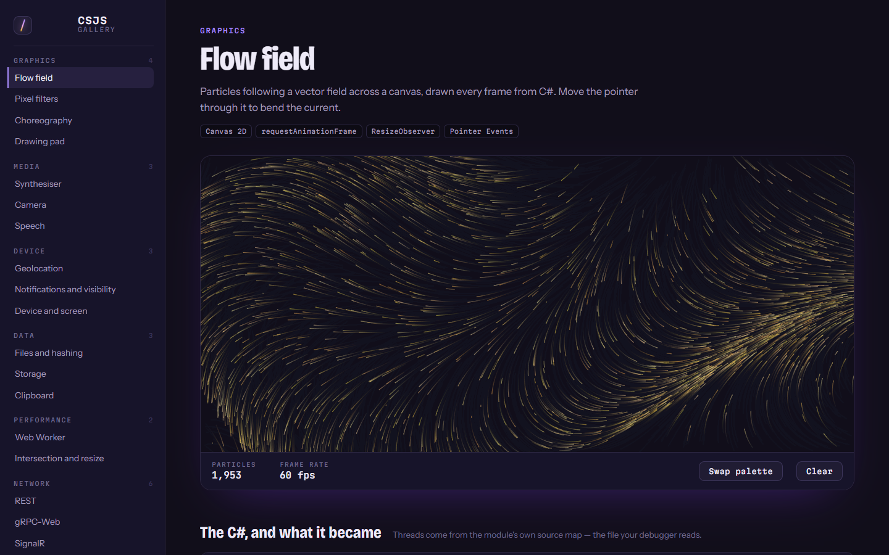 | **Flow field**<br>`#/demo/flow-field` | Particles following a vector field, drawn every frame; the pointer bends the current. | Canvas 2D, requestAnimationFrame, ResizeObserver |
|  | **Pixel filters**<br>`#/demo/image-filters` | Grayscale, sepia, invert, Sobel edges, pixelate, posterize as C# loops over RGBA bytes; a draggable before/after divider. | ImageData, Uint8ClampedArray |
| 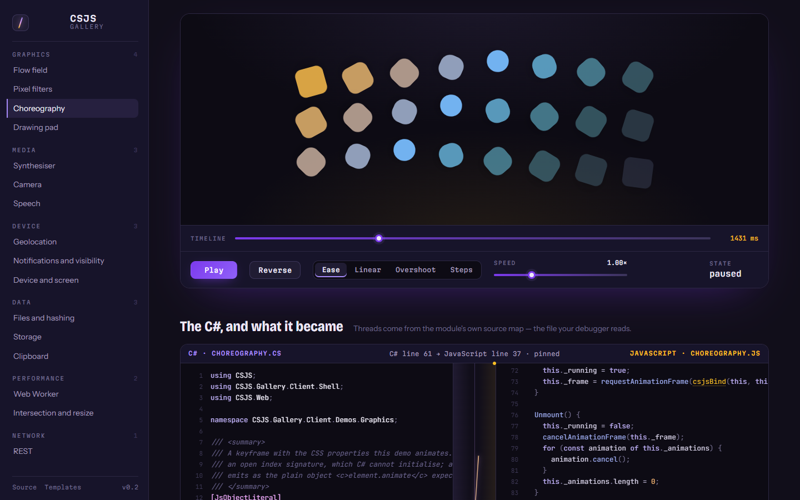 | **Choreography**<br>`#/demo/web-animations` | 24 tiles staggered with `element.animate`; play, pause, reverse, speed, easing, a scrubbable timeline. | Web Animations |
| 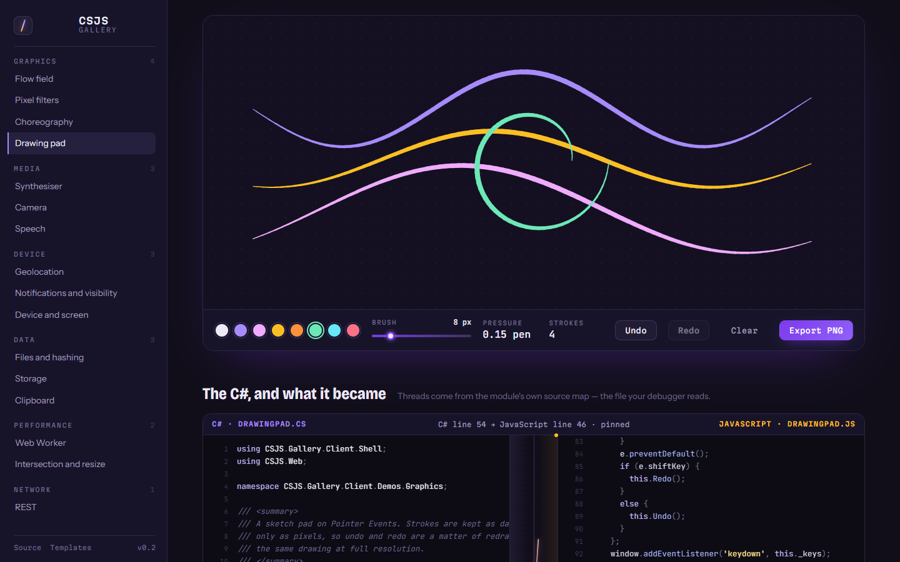 | **Drawing pad**<br>`#/demo/drawing-pad` | Pressure-sensitive strokes from coalesced events, undo/redo, PNG export. | Pointer Events, toDataURL |

### Media

| | Demo | What it shows | APIs |
| --- | --- | --- | --- |
|  | **Synthesiser**<br>`#/demo/web-audio-synth` | Polyphonic oscillators with ADSR and a low-pass filter, a 25-key keyboard, live spectrum and waveform. | Web Audio, AnalyserNode |
| 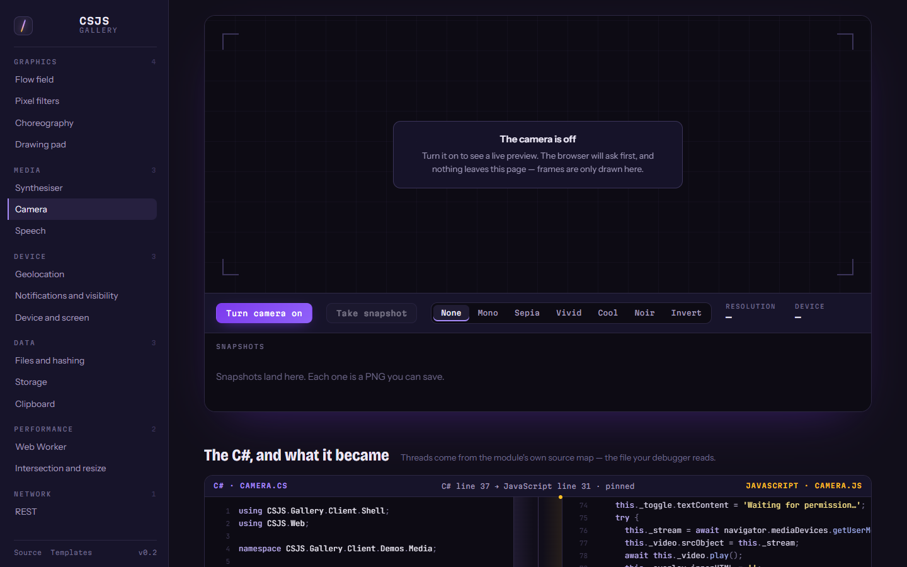 | **Camera**<br>`#/demo/camera` | Live preview with CSS looks and saved snapshots; every failure (no camera, refused, busy, insecure page) explained. | getUserMedia |
| 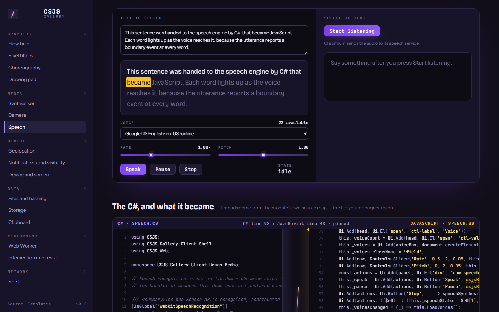 | **Speech**<br>`#/demo/speech` | Voices, rate and pitch, word highlighting from boundary events; recognition where the browser has it. | Speech synthesis and recognition |

### Device

| | Demo | What it shows | APIs |
| --- | --- | --- | --- |
| 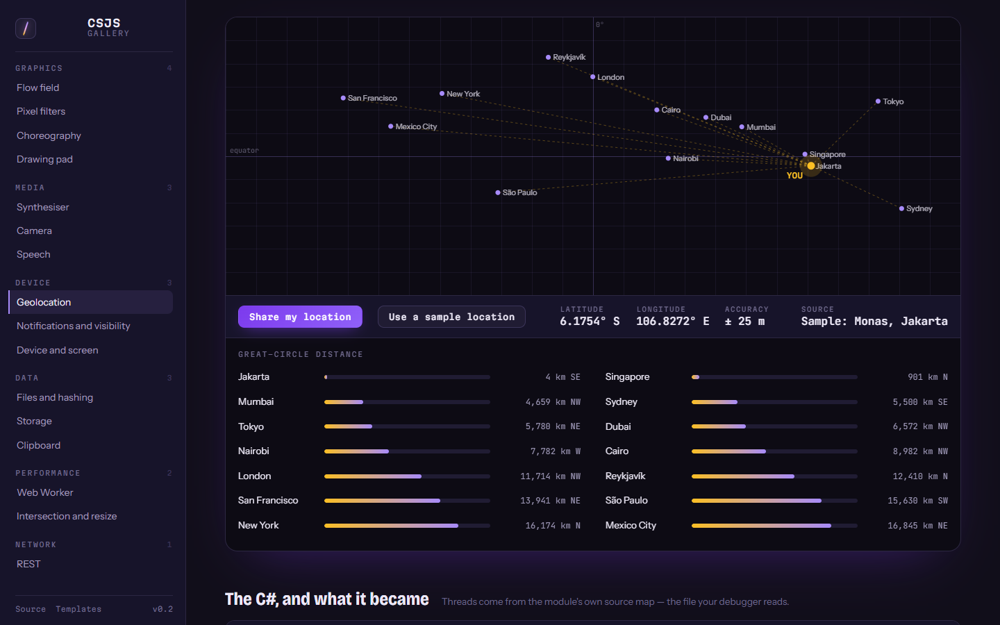 | **Geolocation**<br>`#/demo/geolocation` | Distance and bearing to 14 cities from a watched position, plotted on a world map. | Geolocation |
| 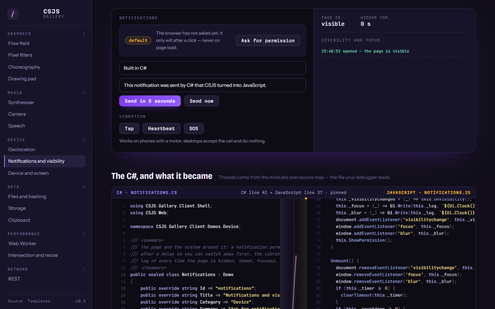 | **Notifications and visibility**<br>`#/demo/notifications` | Permission flow, immediate and delayed notifications, vibration, a log of visibility and focus. | Notifications, Page Visibility, Vibration |
| 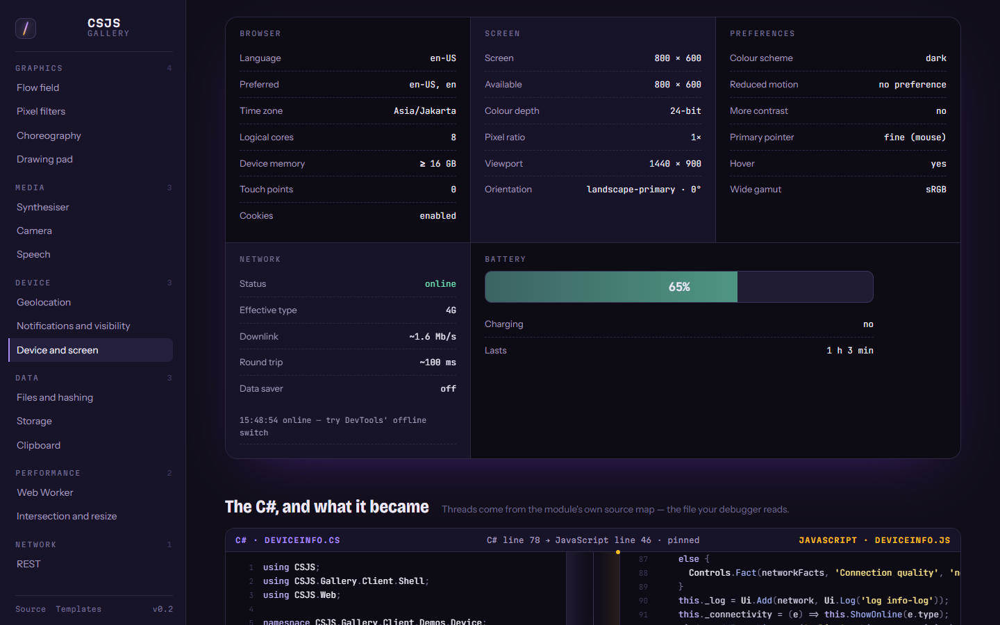 | **Device and screen**<br>`#/demo/device-info` | Navigator, screen and viewport facts, six live media queries, connection and battery. | matchMedia, Network Information, Battery |

### Data

| | Demo | What it shows | APIs |
| --- | --- | --- | --- |
| 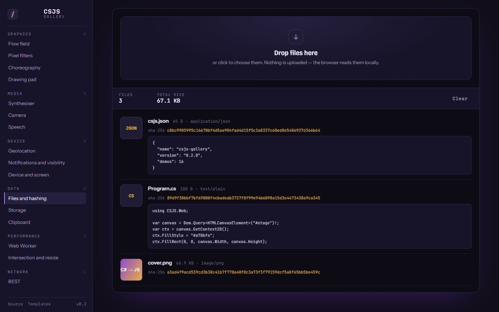 | **Files and hashing**<br>`#/demo/files-and-hashing` | Drop files to preview them and hash them with SHA-256. | File API, drag and drop, Web Crypto |
| 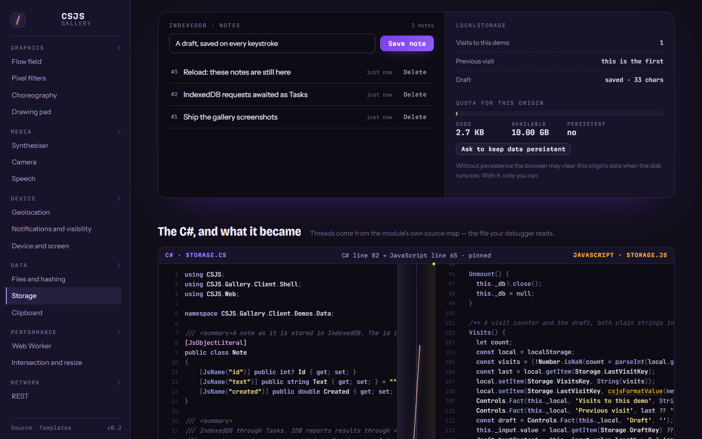 | **Storage**<br>`#/demo/storage` | IndexedDB notes awaited as Tasks, a localStorage draft, quota and persistence. | IndexedDB, localStorage, StorageManager |
| 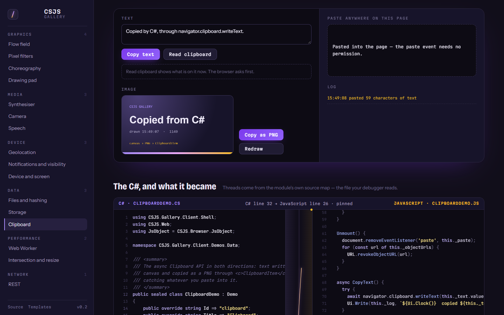 | **Clipboard**<br>`#/demo/clipboard` | Copy and read text, copy a canvas as PNG, listen for pastes. | Async Clipboard, ClipboardItem |

### Performance

| | Demo | What it shows | APIs |
| --- | --- | --- | --- |
|  | **Web Worker**<br>`#/demo/web-worker` | A prime sieve in a C# module worker against the same code on the main thread, with a frame-time chart. | Module workers, postMessage |
| 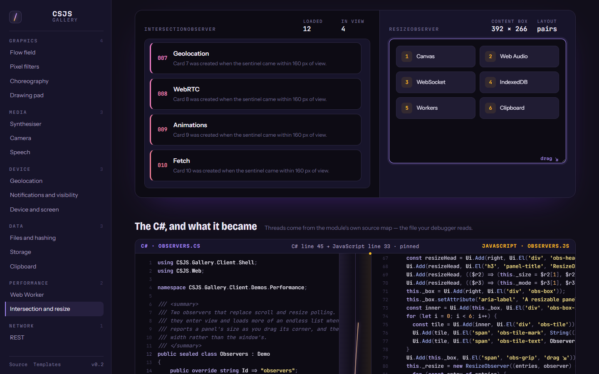 | **Intersection and resize**<br>`#/demo/observers` | Cards revealed on scroll, an endless list, a panel that lays itself out by its own width. | IntersectionObserver, ResizeObserver |

### Network

| | Demo | What it shows | APIs |
| --- | --- | --- | --- |
| 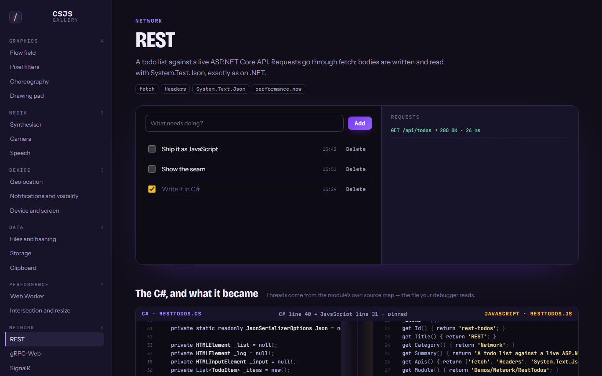 | **REST**<br>`#/demo/rest-todos` | A todo list over fetch, serialised with System.Text.Json. | fetch |
|  | **gRPC-Web**<br>`#/demo/grpc-web` | Unary and server-streaming calls, protobuf encoded and framed by hand in C#, each frame shown in hex. | gRPC-Web, ReadableStream |
| 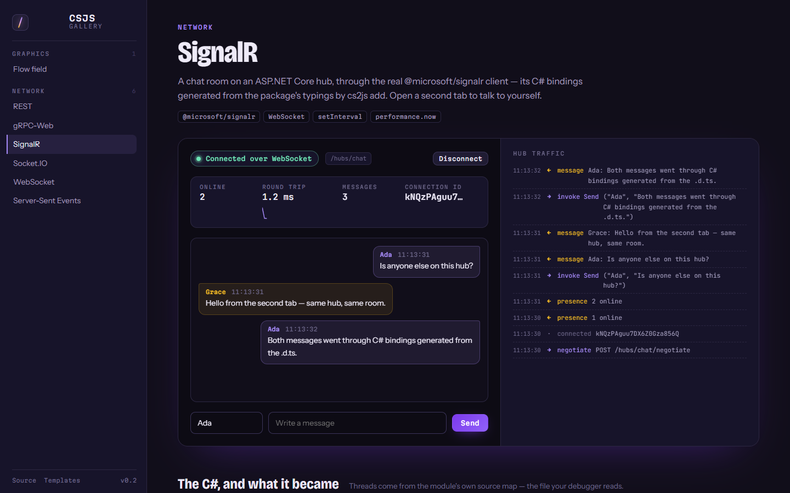 | **SignalR**<br>`#/demo/signalr` | Chat, presence, and round-trip time through the real `@microsoft/signalr` client. | SignalR |
|  | **Socket.IO**<br>`#/demo/socket-io` | A shared whiteboard and chat; late joiners receive the board so far. | socket.io-client |
| 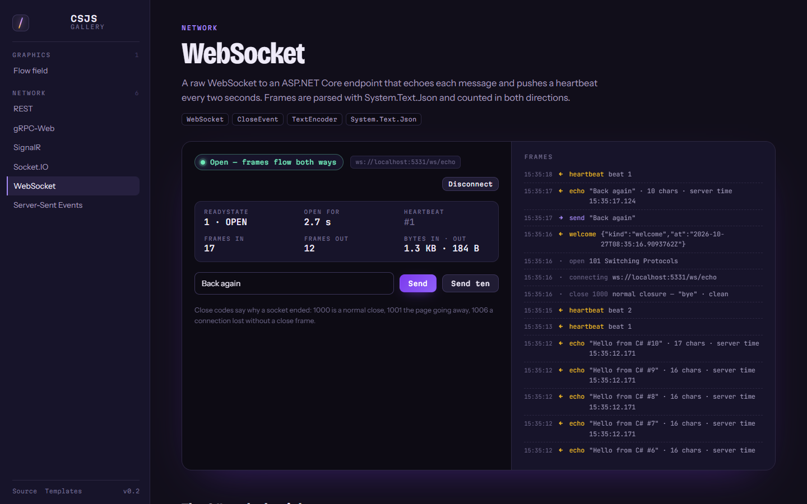 | **WebSocket**<br>`#/demo/websocket` | Raw echo with readyState, byte counters, a heartbeat, and close codes explained. | WebSocket |
|  | **Server-Sent Events**<br>`#/demo/server-sent-events` | A live price chart that resumes from Last-Event-ID without a gap. | EventSource |

Every browser API comes from [`CSJS.Web`](../src/CSJS.Web) — the whole platform as typed C#,
generated from `@types/web` — so the demos are ordinary C# with IntelliSense, not string-built
JavaScript.

## How it is built

```
gallery/
  CSJS.Gallery/          ASP.NET Core host: static site + every playground protocol
    Program.cs           REST (/api/todos), SSE (/sse/ticker), endpoints below
    Realtime/            gRPC Greeter (+ gRPC-Web), SignalR ChatHub, Socket.IO server, WebSocket echo
    Protos/gallery.proto
    wwwroot/             index.html, css/gallery.css, js/ (generated — not committed)
  CSJS.Gallery.Client/   the browser side, all C#
    src/Shell/           router, catalogue, pages, highlighter, source-map decoder, the seam
    src/Demos/<Category>/ one file per demo
```

The client is a normal `.csproj` built with the `CSJS.Build` targets — imported from source and
pointed at the CLI built from this repository, so the gallery always exercises the transpiler as
it is. The server project references it with `ReferenceOutputAssembly="false"`, purely so it
builds first.

### The seam

`Shell/CodeSeam.cs` loads a demo's emitted module and its `.js.map`. The map carries the C#
itself (`sourcesContent`), and `Shell/SourceMap.cs` decodes its base64 VLQ `mappings` into
line-to-line links in both directions. Hovering a line on either side selects its partners, scrolls
the other pane to them, and draws an SVG thread across the seam for each pair; clicking pins the
selection. Nothing about the threads is hand-drawn — they are exactly what the transpiler recorded,
which is also exactly what a debugger uses.

The home page's hero shows the seam on `SourceMap.cs` itself: the code drawing the threads is the
code the threads are drawn over.

### The playground server

| Protocol | Endpoint | Notes |
| --- | --- | --- |
| REST | `/api/todos` | Minimal API; the client serialises with `System.Text.Json`. |
| gRPC-Web | `csjs.gallery.Greeter` | `UseGrpcWeb`; the client frames and decodes protobuf by hand in C#. |
| SignalR | `/hubs/chat` | Chat, presence, and a ping for round-trip time. |
| Socket.IO | `/socket.io/` | A small Engine.IO v4 server over WebSocket — .NET has none of its own. |
| WebSocket | `/ws/echo` | Echo with server timestamps, plus a heartbeat every two seconds. |
| SSE | `/sse/ticker` | One `tick` event a second. |

## Adding a demo

1. Create `src/Demos/<Category>/<Name>.cs` with a class deriving from `Shell.Demo`:

   ```csharp
   public sealed class Ripples : Demo
   {
       public override string Id => "ripples";
       public override string Title => "Ripples";
       public override string Category => "Graphics";
       public override string Summary => "What it shows, in one or two sentences.";
       public override string[] Apis => new[] { "Canvas 2D", "requestAnimationFrame" };
       public override string Module => "Demos/Graphics/Ripples";   // its path under src/

       public override void Mount(HTMLElement stage) { … }
       public override void Unmount() { … }                          // stop everything Mount started
   }
   ```

2. Add one line to `Catalog.All` in `src/Shell/Catalog.cs`.

3. `dotnet run --project gallery/CSJS.Gallery` and open `#/demo/ripples`.

`Unmount` matters: navigating between demos must leave no timer, animation frame, socket, stream,
worker, or global listener behind. Reuse the classes in `gallery.css` — `stage-canvas`,
`stage-controls`, `readout`, `stage-split`, `panel`, `log` — so a new demo looks like the rest.

---

Gravicode Studios — led by Kang Fadhil.
